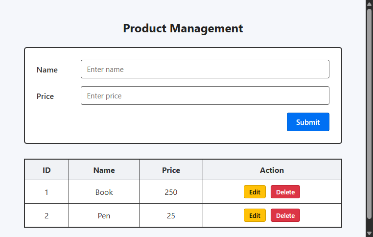

# MERN Lab Task 1: CRUD Operations on Array of Items

A full-stack web application demonstrating **CRUD (Create, Read, Update, Delete)** operations on an in-memory array of items using **HTML, CSS, Vanilla JavaScript, Express.js, and a RESTful API**.

---

## 📸 Output Screenshot

The UI is developed according to the specification/wireframe:



---

## 🛠️ Tech Stack

- **Frontend**: HTML5, CSS3, Modern JavaScript (Fetch API, DOM manipulation)
- **Backend**: Node.js, Express.js
- **Architecture**: REST API Architecture

---

## 🚀 Features

- **Read (GET)**: Fetches and displays all items in an organized tabular format (`ID`, `Name`, `Price`, `Action`).
- **Create (POST)**: Form at the top to add new items with name and price.
- **Update (PUT)**: Click **Edit** on any row to populate the form; updating alters the item dynamically in real-time.
- **Delete (DELETE)**: Click **Delete** with confirmation prompt to remove an item from the list.
- **Responsive & Clean UI**: Styled with clean borders and cards matching the design wireframe.

---

## 📡 REST API Endpoints

| Method | Endpoint | Description | Request Body | Response |
| :--- | :--- | :--- | :--- | :--- |
| **GET** | `/api/items` | Retrieve all items | *None* | `[ { id, name, price }, ... ]` |
| **GET** | `/api/items/:id` | Retrieve item by ID | *None* | `{ id, name, price }` |
| **POST** | `/api/items` | Add a new item | `{ "name": "Book", "price": 250 }` | `{ id, name, price }` |
| **PUT** | `/api/items/:id` | Update an existing item | `{ "name": "Updated Book", "price": 300 }` | `{ id, name, price }` |
| **DELETE** | `/api/items/:id` | Delete an item | *None* | `{ id, name, price }` |

---

## 💻 Getting Started

### Prerequisites

Ensure you have [Node.js](https://nodejs.org/) installed on your machine.

### Installation

1. **Clone the repository:**
   ```bash
   git clone <REPOSITORY_URL>
   cd MERN
   ```

2. **Install dependencies:**
   ```bash
   npm install
   ```

3. **Start the server:**
   ```bash
   npm start
   ```

4. **Open in browser:**
   Navigate to:
   ```
   http://localhost:3000
   ```

---

## 📁 Project Structure

```text
├── public/
│   ├── index.html       # Frontend structure (Form + Data Table)
│   ├── style.css        # Clean custom styling matching wireframe
│   └── script.js        # Client-side REST API integration using Fetch
├── .gitignore           # Ignored files (node_modules, etc.)
├── package.json         # Project metadata and dependencies
├── README.md            # Project documentation with output screenshot
├── screenshot.png       # Screenshot of the working frontend
└── server.js            # Express server & REST API endpoints
```
